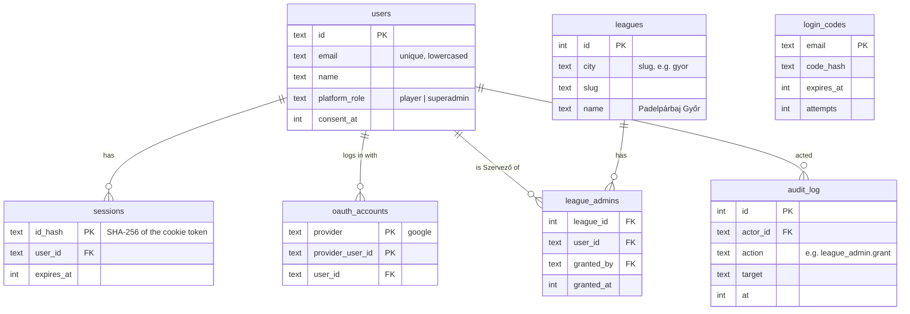
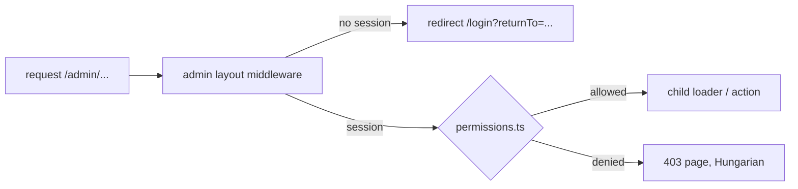
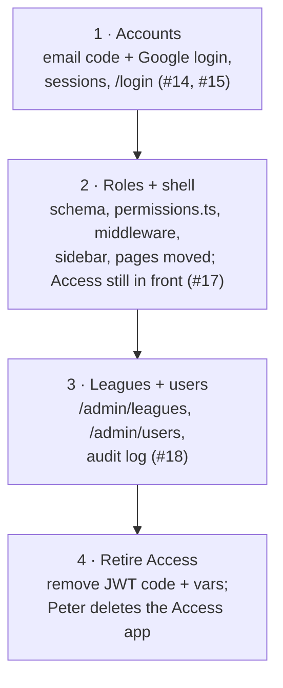

> Historical: this plan is done and kept as history. The current source is the [spec](../spec.md) and the [decision log](../decisions.md).

# Plan: accounts, roles and the admin area

Status: done (2026-10-05). PRs 1–3 shipped together in devel0peter/padel-liga#47; PR 4 (Access retired) right after. Covers devel0peter/padel-liga#14, #17, #18 and #15. Player pages come after this plan.

## 1. Decisions (2026-10-04)

| Topic | Decision |
|---|---|
| Roles | `player` (everyone), `league_admin` (per league), `superadmin` |
| UI labels | Játékos / Szervező / Admin |
| League-admin scope | Per league. Clubs (venues) belong to a city; any Szervező of a league in that city can edit them |
| Superadmin | DB flag on the user, set only by a CLI command. No screen can grant or remove it. Only one separate admin account; the organizer's day-to-day account is Szervező of Győr |
| Who sees what | Admin: interest list, broadcasts, traffic, leagues, users. Szervező: their league + their city's clubs |
| Navigation | Sidebar (shadcn `sidebar`); off-canvas sheet on mobile |
| Login | **No passwords.** Google, or a one-time 6-digit code by email. Same email = same account. No Better Auth: our own small module |
| Sessions | 90 days, extended while active, for players and Szervezők. Admin (work account, rarely used) 12 hours |

These go into the decision log, spec section 2 and spec section 3 (email + password replaced) with the first PR.

## 2. Data model

All tables are ours (Drizzle, migrations in `drizzle/`):

- `platform_role` is never read from a request: only the CLI command writes it.
- Login codes: 6 digits, 10 minutes, at most 5 tries, single use, only the hash stored. A new code replaces the old one.
- Google: OAuth with PKCE and state via `arctic`. Only `email_verified` Google accounts are accepted. A Google login with a known email attaches to that account.
- Session cookie: random 32 bytes, httpOnly, Secure, SameSite=Lax. Only its SHA-256 is stored, so a database leak gives no working sessions. Logout deletes the row; "log out everywhere" deletes all of a user's rows.
- Being a Szervező is a row in `league_admins`, not a role string. Then "Szervező of Győr but not Debrecen" works without parsing anything.
- `audit_log` records every organizer, Admin, command-line and scheduled change, by account id, in the same batch as the change (decision log, D91, #225; spec section 16).

## 3. Authorization

One pure, unit-tested policy module (`app/lib/permissions.ts`), plus server guards that use it.

- `can(user, action, resource)`: a pure function, tested as a full matrix (3 roles × every action × own league / other league / own city's clubs / other city's clubs).
- Guard in **React Router middleware** on the admin layout. A parent loader alone doesn't protect child loaders or actions, because data requests hit them directly. Each league-scoped route also checks the `:league` param against `league_admins`.
- Superadmin passes every check. A superadmin without a `league_admins` row still sees every league (support role).
- Every test runs as a player, as a Szervező of another league, and logged out.

## 4. URLs and sidebar

| Path | Who | Page |
|---|---|---|
| `/login` | everyone | "Belépés Google-lel" or enter your email and get a code. First login asks for name and privacy consent |
| `/auth/google`, `/auth/google/callback` | everyone | OAuth redirect and callback |
| `/profile` | every logged-in user | profile: picture, name, role, login methods, logout everywhere. A page in the app shell like any other |
| `/admin` | Szervező, Admin | overview: redirects to your league, or the Admin home |
| `/admin/leagues/:league` | Szervező | league overview (later: seasons, pairs, groups, disputes) |
| `/admin/leagues/:league/clubs` | Szervező | the city's clubs (moved from `/admin/clubs`) |
| `/admin/signups` | Admin | interest list (today's `/admin`) |
| `/admin/broadcasts`, `/admin/broadcasts/new` | Admin | broadcasts (unchanged) |
| `/admin/traffic` | Admin | traffic (unchanged) |
| `/admin/leagues` | Admin | create a league, appoint and remove Szervezők |
| `/admin/users` | Admin | user list, search, roles shown read-only, "Törlés" (delete or anonymize, #152) |

Old paths (`/admin/clubs`) redirect. `/admin/poster` and `/admin/export.csv` stay where they are, behind the same guard.

The sidebar is one app shell for every logged-in user (2026-10-05). Sections are filtered by role; a section you can't access isn't rendered at all:

- **Top:** logo and the collapse button, then the profile button (Google picture or initials, name, role), which opens `/profile`.
- **League switcher** (later, only with 2+ leagues).
- **Liga:** Áttekintés, Klubok. Seasons and the rest are added here by later tickets.
- **Platform** (tagged "Admin"): Ligák, Városok, Felhasználók, Jelentkezők, Körlevelek, Kimenő levelek, Forgalom, Napló (the audit log, #226). The league section is tagged "Szervező"; players see neither.
- **Bottom:** Kilépés.
- Collapsed (desktop): a narrow icon strip with tooltips; the collapse button stays at its top. Phones: a slide-in panel opened from the page header.
- The current page is marked with a brand-blue tint (`--nav-active`, `--nav-active-bg`), in light and dark mode.

## 5. Design direction

Read as: an internal admin tool for 1–5 organizers, mostly used on a phone link and at a laptop on Mondays. Calm and Linear-like, in the existing brand. (The taste skill says it doesn't cover admin panels, so only its general rules apply here.)

- Dials: variance 3, motion 2, density 5. Static UI with hover, active and focus states only.
- Existing tokens: court blue `--primary` as the one accent, ball yellow only in the logo dot. Archivo, light and dark from the system setting (the `--sidebar-*` tokens already exist in `app.css`).
- One radius scale (the shadcn `--radius`). No cards for grouping, only spacing and `divide-y`. Tables use the existing shadcn `table`.
- Every list gets an empty state that says how to fill it, a skeleton while it loads, and inline form errors under the field.
- Icons: `lucide-react` (already a dependency; the skill allows it when the project already uses it).
- New shadcn components: `sidebar`, `sheet`, `dropdown-menu`, `avatar`, `separator`, `skeleton`, `tooltip`, `sonner` (toasts for saved and sent).

## 6. Delivery (one PR each, in order)

1. **Accounts.** Email code (template in `templates.ts`, sent at once, ahead of the daily-limit queue) and Google login, sessions, `/login` and first-login profile (name, privacy consent), privacy page updated for accounts (Google as a login option). Sign-up is **invite-only until 2 Nov**: an unknown email or Google account gets in only with an invite token. The same invite later serves the interest-list invites (#20). Peter: create the OAuth client in Google Cloud Console (consent screen with the privacy page URL), and add the Cloudflare rate-limiting rule.
2. **Roles and shell.** Schema from section 2, `permissions.ts` with the matrix tests, middleware guard, the 403 page, the sidebar layout, existing pages moved and redirected. CLI: `npm run admin:superadmin -w app -- <email> [--remote]` sets the flag and writes the audit row. During this step Cloudflare Access stays in front of `/admin`, so the admin is protected by both.
3. **Leagues and users.** Create the Győr league and appoint Szervezők by the email of an existing account (an unknown email gets an invite). The user list shows no phone numbers.
4. **Retire Access.** After you've logged in on prod as Admin: remove `access.server.ts` and the `ACCESS_*` vars, then you delete the Access app in the dashboard.

Every PR is flagged for human review (auth and personal data).

## 7. Settled points (2026-10-04)

1. **No passwords.** Google for most people, a one-time email code for the rest. No password hashing to maintain or be responsible for, and it fits the Workers Free plan's 10 ms CPU limit. Better Auth and Workers Paid were considered and dropped.
2. **Two accounts for the organizer.** A separate account is the only Admin and logs in with Google. The organizer's day-to-day account is a normal player and the Szervező of Győr. The Admin address is passed to the CLI command, not written in the repo.
3. **Rate limiting:** a Cloudflare WAF rate-limiting rule on `POST /login` and `/auth/*`, by IP (the Free plan includes one rule), set by Peter in the dashboard. Plus at most 5 code requests per email per hour in our own code.

## 8. Email volume (agreed 2026-10-04)

Login codes are few with 90-day sessions. The volume comes from match notifications, which should stay lean: one new-phase email per phase, "action needed" only to the pair who must act, a deadline reminder only for unscheduled matches, and at most one digest per player per day. That's about 4–5 emails per player per phase (~700 a month at 100 players).

- **Now:** Workers Free + Resend free (3,000 a month, **100 a day**).
- **When Resend becomes the bottleneck** (e.g. the Monday new-phase email outgrows 100 a day): either a bigger Resend plan, or Workers Paid ($5/month) + Cloudflare Email Service (3,000 a month included, then $0.35 per 1,000). Switching provider is a one-file change behind the outbox; test deliverability to Gmail and freemail.hu first.
