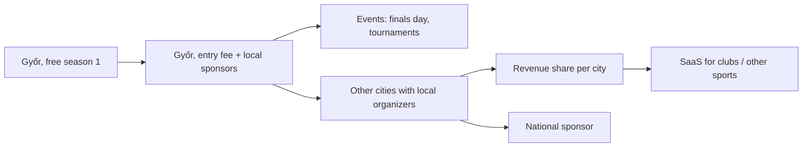

# Monetization: ideas and notes

Status: **ideas only, not a priority** (2026-10-02). Nothing here is decided or scheduled. Use it as a lens when choosing directions, so we don't close doors by accident.

All numbers below are rough guesses to compare options, not forecasts. Check them before relying on any of them.

## Honest outlook

- **Covering the running costs: very likely.** Hosting is near zero; a small entry fee from one city covers it many times over.
- **Side income: possible**, if several cities run leagues and players accept a fee.
- **Salary-level income: unlikely from Hungarian padel leagues alone.** The market is small: a few hundred to a few thousand active league players nationwide at best. Bigger upside needs other countries, other sports, or selling the platform to clubs.
- The real costs are **time** (organizing, support, disputes) and **admin overhead once money is collected** (legal form, invoicing, accountant), not servers.

## Running costs (expected)

| Item | Cost | When |
|---|---|---|
| Domain `padelparbaj.hu` | a few thousand Ft/year | Now |
| Cloudflare Workers + D1 | Free tier; Workers Paid is $5/month | If we outgrow the free limits |
| Resend (email) | Free up to 3,000 emails/month, then ~$20/month | Grows with players × reminders |
| Google Workspace (`hello@`) | Already paid (Psionic Flare) | — |
| Payment provider (Barion, Stripe, SimplePay) | ~1.5–3% per transaction | Only once we take payments |
| Accountant / invoicing | Can be 10,000–30,000 Ft/month if a new legal form is needed | Only once we take payments; possibly the largest cost |
| Prizes, finals day, printing (posters) | Variable | Per season |

Takeaway: keep the infrastructure on free tiers as long as possible. The first real money question is **how to collect fees legally** without the admin eating the income.

## Revenue ideas

Ordered roughly by how realistic they are for us.

### 1. Player entry fee per season
- The most direct model, but off the table for now: no plans to charge players (2026-10-04). The landing page says *"Nevezési díj nincs"*.
- Guess: 3,000–6,000 Ft per player per season (about the price of one or two court bookings).
- Value to sell: organized weekly matches, fair walkover rules, rankings, Elo, prizes, season finals.
- Options: early-bird price, discount for returning pairs, free spot for whoever brings a new pair.

### 2. Local sponsors
- Padel shops, racket brands, sports drinks, physiotherapists, gyms, local restaurants or bars (post-match).
- What they get: logo on standings pages, emails, posters and social posts; "a forduló meccse by X"; prizes for group winners; naming rights ("Padelpárbaj Győr, powered by X").
- Works better once there's an audience to show: player count, page views, social reach.

### 3. Club partnerships
- Clubs gain bookings from the league. We already record the venue for every match, so we can prove it.
- Models: a small fee per league booking, a flat fee per season for "partner club" status, or in-kind (discounted league slots, free court for the finals day).
- Risk: charging clubs can undermine the neutral, city-wide position. In-kind deals are safer early on.

### 4. Events
- Season finals day, mixed or "random partner" tournaments, clinics with a coach.
- Entry fee per event, plus sponsor visibility. A single event can earn more than a season's fees, and it also recruits players.

### 5. Other cities (organizer model, phase 3)
- A local organizer runs each city; we provide the platform and the playbook.
- Models: revenue share of entry fees (e.g. 20–30% to the platform), or a fixed fee per player per season.
- This is where the scaling happens, but each city depends on finding a committed organizer.

### 6. Selling the platform (SaaS / white label)
- Clubs or federations running their own box leagues with their own branding, for a monthly fee.
- Other sports with the same format: tennis, pickleball, squash, table tennis. Same engine, different brand (per the multi-tenant decision).
- Other countries need multi-language support (currently out of scope; the UI is Hungarian only).
- Biggest upside, but also a different business: sales, support, uptime expectations.

### 7. Premium player features (freemium)
- Free to play; paid extras such as detailed stats, Elo history charts, head-to-head records, season certificate or highlights.
- Probably weak: small communities rarely pay for extras. Better as a perk bundled into the entry fee.

### 8. Smaller extras
- Merch: league T-shirts for winners, or sold at cost plus a margin.
- Affiliate links: racket and gear shops.
- Ads: not worth it at our scale, and they would make the site worse.

## Rough scenarios (per year, gross)

Assumes 3 seasons per year and 5,000 Ft per player per season.

| Scenario | Players | Gross | Notes |
|---|---|---|---|
| Győr only, small | 32 (16 pairs) | ~480,000 Ft | Covers costs, small surplus |
| Győr only, healthy | 64 (32 pairs) | ~960,000 Ft | Plus a sponsor or two |
| 5 cities, 25% revenue share | 5 × 48 | ~900,000 Ft to the platform | Each organizer keeps the rest |
| 20 cities, 25% revenue share | 20 × 48 | ~3,600,000 Ft to the platform | Needs national awareness |

Before taxes, payment fees and accounting. Sponsors and events come on top.

## Keep in mind when choosing directions

Cheap now, expensive to retrofit later:

- **Multi-tenant stays clean.** Already decided. Per-league settings should be able to hold an entry fee and a sponsor later.
- **Registration needs a payment status** eventually (free / unpaid / paid). Start manual (bank transfer, organizer marks it paid) before integrating a provider. Barion and SimplePay are common in Hungary; Stripe also works.
- **Keep recording the venue per match.** Club booking reports are the basis of any club deal.
- **Reserve space for sponsor visibility** in the layout (standings, emails, share images), without building it yet.
- **Track reach**: player counts, page views (Cloudflare Web Analytics), social followers. Sponsors ask for these numbers.
- **Don't promise "free forever"** anywhere. "Nevezési díj nincs" states the present, nothing more.
- **Personal data stays with us.** Never sell or share player data with sponsors; any sponsor email needs explicit opt-in consent. Needs review against the privacy page (`/privacy`).
- **Keep hosting on free tiers** and avoid paid services until there's income.

## Open questions (for later)

1. Who collects the money: Peter privately, an existing company (e.g. Psionic Flare), a new sole proprietorship, or a sports association (egyesület)? Each has different tax and invoicing rules. **Ask an accountant before taking any payment.**
2. Is the entry fee per player or per pair? Refunds when a pair drops out mid-season?
3. Do prizes come from fees, sponsors, or both?
4. Revenue share or fixed fee for other cities' organizers?
5. Does charging clubs conflict with staying venue-neutral?
