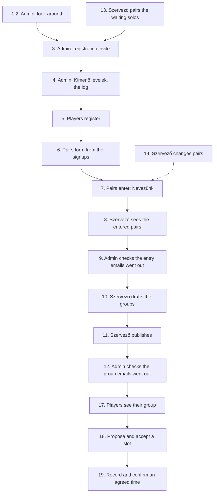

# Milestone 1 walkthrough (local)

A click-through checklist for milestone 1, "Registration opens": from the registration invite to published groups. It runs on a local database filled with fake data (#90). Nothing in it can reach production, and nothing is ever emailed: the local dev server logs every email to the console.

The page labels below are the Hungarian ones you see on screen.

`npm run e2e` runs the same steps in a browser on its own local database (#101, see the README). Which spec covers which step:

| Steps | Spec |
|---|---|
| 1-2 | [`01-admin-setup.spec.ts`](../app/e2e/01-admin-setup.spec.ts) |
| 3-4 | [`02-invite.spec.ts`](../app/e2e/02-invite.spec.ts) |
| 5-6 | [`03-register.spec.ts`](../app/e2e/03-register.spec.ts) |
| 5, partner without an email (#96) | [`04-partner-email.spec.ts`](../app/e2e/04-partner-email.spec.ts) |
| 7-9 | [`05-entries.spec.ts`](../app/e2e/05-entries.spec.ts) |
| 10-12 | [`06-groups.spec.ts`](../app/e2e/06-groups.spec.ts) |
| 11, a pair entering after publishing | [`07-late-entry.spec.ts`](../app/e2e/07-late-entry.spec.ts) |
| 13 | [`08-solos.spec.ts`](../app/e2e/08-solos.spec.ts) |
| 14 | [`09-pairs.spec.ts`](../app/e2e/09-pairs.spec.ts) |
| 14, search, filter and Levél nekik (#148) | [`15-pairs-filter.spec.ts`](../app/e2e/15-pairs-filter.spec.ts) |
| 15 | [`11-open-signup.spec.ts`](../app/e2e/11-open-signup.spec.ts) |

## Set up

1. Install and configure once, from the repo root:
   - `npm ci`
   - Copy `app/.dev.vars.example` to `app/.dev.vars`. Set `TURNSTILE_SITE_KEY=""` (an empty key means no bot check, so asking for a login code works locally). Leave `RESEND_API_KEY=""`, `SMTP_USER=""` and `SMTP_PASSWORD=""` empty: with a Resend key or a relay login, every email of the walkthrough would really be sent to the fake addresses. Without a relay login the daily limit is 100 (`EMAIL_DAILY_LIMIT`), about what a full run sends: set `EMAIL_DAILY_LIMIT="1000"` in `.dev.vars` so no email waits for the next day.
2. Migrate and seed the local database:
   - `npm run db:migrate:local -w app`
   - `npm run db:seed:local -w app`
3. Start the app with `npm run dev` and open <http://localhost:5173>.

The seed takes no options and refuses `--remote`, a production environment and CI. It only writes the local D1. Run it again at any time to start over: it deletes everything on `@example.test`, and the city "Mintaváros" with its league, clubs and signups (including everything a walkthrough created on top: accounts, pairs, entries, groups, emails) and writes the same starting state again. Round 1 starts on the Monday about two weeks from the day you seed.

### What the seed contains

| Thing | Value |
|---|---|
| City | Mintaváros (listed), league "Padelpárbaj Mintaváros", slug `minta` |
| Clubs | Minta Padel Aréna, Teszt Sportcentrum, Példa Padel Club |
| Season | "Teszt szezon": registration open since yesterday, closes the Sunday before round 1; round 1 starts about two weeks out |
| Admin | `admin@example.test` (Teszt Admin) |
| Szervező | `szervezo@example.test` (Teszt Szervező) of Mintaváros |
| Signups | 10 pair signups and 4 solo signups, below |
| Player accounts | none: players register in step 5 |

The Admin and the Szervező already have accounts. Everyone else has only a signup, so they register themselves.

Pair signups (both players are named, so both get the registration invite). The level is the pair's shared signup level; it prefills the first-login page.

| # | Player 1 | Player 2 | Level |
|---|---|---|---|
| 1 | Kovács Anna `kovacs.anna@example.test` | Nagy Bence `nagy.bence@example.test` | Versenyző |
| 2 | Szabó Eszter `szabo.eszter@example.test` | Tóth Gergő `toth.gergo@example.test` | Haladó |
| 3 | Horváth Zsófia `horvath.zsofia@example.test` | Molnár Dávid `molnar.david@example.test` | Haladó |
| 4 | Farkas Lilla `farkas.lilla@example.test` | Papp Ádám `papp.adam@example.test` | Középhaladó |
| 5 | Takács Nóra `takacs.nora@example.test` | Juhász Bálint `juhasz.balint@example.test` | Középhaladó |
| 6 | Mészáros Réka `meszaros.reka@example.test` | Simon Levente `simon.levente@example.test` | Középhaladó |
| 7 | Török Hanna `torok.hanna@example.test` | Fehér Márk `feher.mark@example.test` | Középhaladó |
| 8 | Balogh Petra `balogh.petra@example.test` | Rácz Zoltán `racz.zoltan@example.test` | Kezdő |
| 9 | Lakatos Vivien `lakatos.vivien@example.test` | Gulyás Tamás `gulyas.tamas@example.test` | Kezdő |
| 10 | Oláh Kinga `olah.kinga@example.test` | Fodor Péter `fodor.peter@example.test` | Kezdő |

Solo signups:

| Player | Level | State |
|---|---|---|
| Varga Dóra `varga.dora@example.test` | Középhaladó | paired with Kiss Miklós by a Szervező |
| Kiss Miklós `kiss.miklos@example.test` | Középhaladó | paired with Varga Dóra |
| Pál Boglárka `pal.boglarka@example.test` | Kezdő | waiting for a partner |
| Sándor Ákos `sandor.akos@example.test` | Haladó | waiting for a partner |

### Logging in as a seeded user

There are no passwords. On <http://localhost:5173/login>:

1. Type the address and press "Kódot kérek".
2. Read the code in the terminal where `npm run dev` runs: a line `[email] to=<address> subject=...`, with the code as `NNN NNN` in the subject and the text.
3. Type the code in "Belépőkód" and press "Belépek".

Every user needs their own session. Use one browser window per account (a private window or a separate profile), or log out first: <http://localhost:5173/logout>. The Admin's session lasts 12 hours.

### Where emails show up

Every email goes out by itself, as soon as it is made (#112). In the local dev server it is printed to the terminal as `[email] to=... subject=...` and the text, and that is how you read what a player would get. "Kimenő levelek" (`/admin/outbox`, Admin only, sidebar section Platform) is the log: per kind, how many emails wait, went out and failed, with the newest failure's reason; never an address.

The links in those emails point to `https://padelparbaj.hu/...`. Locally, open the same path on <http://localhost:5173> instead (for example `/login?email=...`).

## The flow

## Steps

Steps 1 to 12 and 17 to 19 are the main line. Steps 13 to 16 are side paths you can do any time after step 5.

### 1. Admin logs in

- Page: `/login`, then `/home` (Kezdőlap)
- Account: `admin@example.test`
- Expect:
  - You land on Kezdőlap with a "Teszt szezon" card (league Padelpárbaj Mintaváros): "Nevezés" dates, the four rounds with their deadlines, "Szezon vége:".
  - The sidebar shows "Platform" with the tag Admin, and a league section "Padelpárbaj Mintaváros" with the tag Szervező: Áttekintés, Szezonok, Párkeresők, Klubok.
  - No "Nevezünk" button: the Admin has no pair, so the card says "Nevezni párban lehet, és még nincs párod." with a link to Párom.

### 2. Admin checks the setup pages

- Account: `admin@example.test`
- Pages and expected results:
  - `/admin/cities` ("Városok"): Mintaváros is there and listed (shown on the signup form).
  - `/admin/leagues` ("Ligák"): Padelpárbaj Mintaváros with the organizer Teszt Szervező.
  - `/admin/leagues/minta/clubs` ("Klubok: Mintaváros"): the three clubs. "Inaktiválás" on one turns it off, "Aktiválás" turns it on again (deactivate instead of delete, #19). Leave all three active.
  - `/admin/leagues/minta/seasons` ("Szezonok"): the Teszt szezon with its four rounds, a link under "Nevezések" (0 nevezett) and "Csoportok" under "1. kör". Try "Új szezon" with a start day that is not a Monday: it must be refused.
  - `/privacy`: opens without login; check that it describes pairs, season entries, the group emails and how long email text is kept.

### 3. Admin sends the registration invite

- Page: `/admin/signups` ("Jelentkezők")
- Account: `admin@example.test`
- Expect:
  - The header reads "14 jelentkezés · 10 pár · 4 egyéni · 24 játékos".
  - The button reads "Regisztrációs meghívó (24 cím)": both players of the 10 pair signups (20) plus all 4 solos. Pál Boglárka and Sándor Ákos still wait for a partner, so theirs says "Még keresünk neked párt, addig regisztrálj."
- Do: press the button, check the text of the dialog "Küldöd a regisztrációs meghívót?", press "Küldés".
- Expect:
  - The dialog says "Meghívók elindultak": "24 levél a háttérben megy ki, a napi limit szerint; ami ma nem fér bele, holnap. Hogy hol tart, a Kimenő levelek oldalon látod." The dialog answers at once; the emails go out right after it, in the background (#140). (Above 50, only the first 50 go at once and the rest with the cron every 10 minutes, within the daily limit.)
  - The button is now disabled (everyone is invited once).
  - The terminal prints 24 `[email] to=...` blocks, one per invited address, each with a link `https://padelparbaj.hu/login?email=<address>`.

### 4. Admin checks the log

- Page: `/admin/outbox` ("Kimenő levelek")
- Account: `admin@example.test`
- Expect:
  - A row "Regisztrációs meghívó" with 0 waiting, 24 sent, 0 failed, and no failure. Login codes and signup confirmations have their own rows once there are some.
  - No address anywhere on the page, and no button: nothing waits for the Admin.

### 5. Players register

- Page: `/login?email=<address>` (on localhost), then `/welcome` ("Üdv!"), then `/home`
- Accounts: the players from the tables above. Minimum: both players of 3 pair signups (6 logins, enough for one group of 3 pairs). For the full run use the 22 players who start with a partner: 11 pairs split into groups of 4, 4 and 3.
- Per player:
  1. Open the link from the terminal with the host changed to `http://localhost:5173`. The address is already filled in; press "Kódot kérek" and log in with the code from the terminal.
  2. On "Üdv!": check the line "A jelentkezésedből már megvan a neved és a szinted. Csak a telefonszámod kell, és hogy férfi vagy nő vagy.", that "Neved" already holds the name from the table and "Szinted" the signup's level (#130), leave the phone empty (or try a Hungarian number), pick "Férfi" or "Nő" (nothing is preselected, #133), tick the privacy consent and press "Kész".
- Expect:
  - Without the consent, the name or Férfi/Nő, the form shows an error and stays.
  - After "Kész" you land on Kezdőlap.
  - The first player of a pair opens "Párom" (`/pair`) and sees "A párod, <name>, még nem regisztrált." (the name, never the address).

### 6. The second partner registers, the pair forms

- Page: `/pair` ("Párom")
- Account: the second player of the pair, right after step 5 for them
- Expect:
  - After "Kész" the pair exists: Párom shows the partner's name. No invite step is needed.
  - The first partner sees the same after a reload.
  - A "Nevezés" card with the "Teszt szezon" and a "Nevezünk" button.
- Check for a pair of two solos (Varga Dóra and Kiss Miklós): the same, because the Szervező paired them before.

### 7. A pair enters the season

- Pages: `/pair` or `/home`
- Account: either player of a pair
- Do: press "Nevezünk".
- Expect:
  - "Beneveztetek: az 1. körtől játszotok (kezdés: ...)." and, after a reload, "Beneveztetek: az 1. körtől játszotok." The entry counts at once: there is no organizer approval (#153).
  - The button is gone: a pair can enter a season once. The partner sees the same status.
  - Both players get "Beneveztetek" on Értesítések, and the terminal prints the "Beneveztetek" email to each of them at once (not to a player who switched email off on the profile).
- Repeat for every pair.

### 8. Szervező sees the entered pairs

- Page: `/admin/leagues/minta/seasons/<id>/entries` ("Nevezések: Teszt szezon"), linked from "N nevezett" on Szezonok
- Account: `szervezo@example.test` (only the Mintaváros league pages show in their sidebar)
- Expect:
  - "N nevezett pár". Each row has the two names, their levels, the pair's average starting Elo, when they entered and the round they start in.
  - Nothing to approve or reject, and no "függőben".

### 9. Admin checks the entry emails went out

- Page: `/admin/outbox`
- Account: `admin@example.test`
- Expect: a row "Nevezés" with two sent emails per pair (one fewer for a player who switched email off) and nothing waiting.

### 10. Szervező drafts the groups

- Page: `/admin/leagues/minta/seasons/<id>/groups` ("Csoportok: Teszt szezon"), the "Csoportok" link in the "1. kör" column of Szezonok
- Account: `szervezo@example.test`
- Expect before drafting: a button "Csoportok javaslata". With 0, 1, 2 or 5 entered pairs there is no draft, only a message saying why.
- Do: press "Csoportok javaslata".
- Expect:
  - Cards "1. csoport", "2. csoport", ...; the strongest pairs (by Elo) in group 1. 11 pairs make 4, 4 and 3; 10 make 4, 3 and 3. Each pair shows its Elo.
  - Move a pair with the select "N. csoportba": the target group is re-seeded. A group of 2 or 5 shows a warning badge and "Közzététel" is disabled until every group has 3 or 4 pairs.
  - "Újragenerálás" throws the moves away and drafts again.

### 11. Szervező publishes the groups

- Page: the same
- Account: `szervezo@example.test`
- Do: press "Közzététel", read "Közzéteszed a csoportokat?", confirm.
- Expect:
  - The terminal prints one email per player: the group, the opponents' names per week (or the rest week), the deadline and a link. No email address of another player is in any of them.
  - The groups are locked: no select, no "Újragenerálás". The "1. kör" link on Szezonok now reads "Közzétéve", and the season can't be edited or deleted.
  - A pair in a published group can't be dissolved or changed ("Felbontás" and "Partner cseréje" on Párok are disabled, with the reason, until the round's deadline).
  - A pair entering after publishing joins round 2 (to see it, keep one pair out of step 7 until now, then let it enter: "Beneveztetek: a 2. körtől játszotok.").

### 12. Admin checks the group emails went out

- Page: `/admin/outbox`
- Account: `admin@example.test`
- Expect: a row "Kihirdetett csoportok" with one sent email per player and nothing waiting.

### 13. Szervező pairs the waiting solos (side path)

- Page: `/admin/leagues/minta/solos` ("Párkeresők")
- Account: `szervezo@example.test`
- Expect: "2 egyedül jelentkező keres párt, 1 párt hoztál össze": Pál Boglárka and Sándor Ákos in the table, by level. The page never shows their addresses.
- Do: tick both, press "Párba teszem (2/2)", confirm.
- Expect:
  - "0 egyedül jelentkező keres párt, 2 párt hoztál össze".
  - The terminal prints the two "Párkeresők bemutatása" emails, and "Kimenő levelek" counts them as sent.
  - They got the registration invite already (step 3). Register them as in steps 5 to 7: their pair forms like the others once both have registered. "Szétválasztom" on this page undoes a pairing.

### 14. Szervező changes pairs (side path)

Players can't invite a partner or dissolve a pair themselves: the Szervező does it.

- Page: `/admin/leagues/minta/pairs` ("Párok")
- Account: `szervezo@example.test`
- Expect: every pair of the league with both names and levels, the average starting Elo, the source ("jelentkezésből" or "kézzel"), "Aktív" or "Felbontva", and the entry status in the current season. No email address anywhere.
- Expect, above the filter (#237): a small table, "Párok" and "Játékosok" per state (Nevezett, Nem nevezett, Elutasítva, Visszavonva, "Nincs párja" with players only, "Felbontott párok" with pairs only) and "Összesen". A label opens the list with that filter, and its number is the rows (or their players) shown; a search or a filter doesn't change the table. At 390px it fits without sideways scrolling.
- Do:
  1. "Pár létrehozása": pick two registered players without a pair (for example two whose signup partner hasn't registered), press "Létrehozás". The new pair shows with "kézzel".
  2. "Partner cseréje" on a pair: pick who stays and the new partner, press "Csere". The old pair reads "Felbontva", the new one "kézzel".
  3. "Felbontás" on a pair, confirm. It reads "Felbontva"; an entry it hasn't played in reads "Visszavonva".
  4. "Benevezés" under "Nem nevezett" on the new pair, confirm (the dialog names the pair). It reads "Nevezett", with the round it starts in ("a 2. körtől" after step 11). Try it on a pair where a player has no level: refused, naming the player.
  5. "Kivétel a szezonból" on that pair, confirm. It reads "Visszavonva" and stays "Aktív"; "Benevezés" enters it again. Pick "Visszavonva" in the filter: the rows' badge uses the same word. Both players' Párom reads "A szervező kivett titeket a szezonból. Ha újra játszanátok, szóljatok neki…", with no "Nevezünk" button.
  6. Type a name in "Keresés" without accents (for example "kovacs"): only the matching rows stay, and the address has `?q=`. "Szűrők törlése" brings every row back.
  7. Press "Nincs a ligában (N)": exactly N rows, the players without a pair ("Nincs párja", "Párt keres" where the switch is on) and the pairs without an entry. A reload keeps it. As `admin@example.test`, "Levél nekik" opens "Új körlevél" with those players as recipients ("Lista"); don't send.
- Expect:
  - Nothing new in the terminal or on Kimenő levelek: no email goes out for a pair change or an entry change.
  - The players see the change on Párom; an entry change also on Értesítések ("A szervező benevezett titeket", "A szervező kivett titeket a szezonból"). From here a new pair can also enter the season itself (step 7).
  - After step 11, a pair in a published group has both pair buttons disabled, with the reason, and "Kivétel a szezonból" opens "Visszaléptetés a csoportból" (#34): it needs a reason, and says the pair's matches leave the table and the pair leaves the season. After it the pair reads "Visszavonva", its pair buttons work again, and "Benevezés" enters it for the next round. The group's table on `/league/minta` no longer lists it (it is named below the table, "Visszalépett: …"), its matches there are gone, its players' Kezdőlap shows no group, and the other pairs' group table on Kezdőlap leaves it out, names it below ("Visszalépett: …") and shows its week's match as off. Értesítések: the pair got "A szervező visszaléptetett titeket a körből" with the reason; the others "Visszalépett egy pár a csoportodból" with no reason. No email.

### 15. A new player without a signup registers (side path)

Anyone can create an account, no invite needed (#113).

- Page: `/register` (or `/login`), then `/welcome`, `/home` and `/pair` ("Párom")
- Account: a new address that is not in the seed, for example `uj.jatekos@example.test`
- Do: ask for a login code, enter the code from the terminal, then fill in the first-login page (name, level, phone, consent) and press "Kész".
- Expect:
  - The code arrives like for anyone else; nothing about 2 November.
  - Under the code field: "Nem jött meg? Nézd meg a spam mappát is, adj meg másik címet, vagy írj nekünk: hello@padelparbaj.hu." (with "lépj be Google-lel" / "regisztrálj Google-lel" before the last part when Google login is set up). The same line for every address, also one that gets no code (#123).
  - The first-login page names no partner and prefills no level.
  - Kezdőlap and Párom: "Hívd meg a párodat" with the player's own pair link; Párom also says the organizer finds a partner for those with nobody, with the contact address `hello@padelparbaj.hu`.
  - The Szervező can now pick this player on "Párok" (step 14).

### 16. The new player invites a partner with the pair link (side path)

A player without a pair sends their own link; the partner registers and accepts (README decision log, 2026-10-31).

- Page: `/home` as the player of step 15, then the link in a private window, `/register`, `/welcome`, the link again, `/pair`
- Account: another new address, for example `link.partner@example.test`
- Do: copy the link from "Hívd meg a párodat", open it in a private window, press "Regisztrálok", ask for a code, enter it, fill in the first-login page, then press "Elfogadom".
- Expect:
  - Logged out, the link shows "Új Játékos meghívott, hogy legyél a párja." and the league, never an email.
  - `/register` says "Regisztráció" and "Regisztráció Google-lel", the code step "Tovább"; it is the login flow.
  - After "Kész" the partner is back on the link; "Elfogadom" opens Párom with "Mostantól párban vagytok." and the partner's name.
  - Both players' link boxes are gone; on "Párok" the pair's source is "linkkel". No email was queued.
  - The player's own link, opened by themselves, says "Ez a saját linked."

### 17. Players see their group (after step 11)

- Page: `/home` ("Kezdőlap")
- Account: any player in a published group, for example the first pair's first player
- Expect:
  - "Teendők" at the top: "Ajánlj időpontot (<names> ellen)" for each match, each a link to the match.
  - A card "Bronz divízió, 1. csoport" (or "Réz divízió, 2. csoport"): the season, the round and the deadline, the group's pairs with "(ti)" on yours (without numbers until a result is final; then the same table as on the public league page: place, pair, M, P, Szett, Játék, #201), then weeks 1 to 3. With 6 pairs the groups have 3 pairs: 2 matches and one "Pihenőhét".
  - Each match: the opponents, "Egyeztetésre vár", their two phone numbers (tap to call) and "Egyeztetés és részletek". No email address anywhere.
  - "Hamarosan itt lesz a csoportod" is gone.

### 18. A pair proposes slots, the other accepts one

- Page: `/matches/<id>` (from "Egyeztetés és részletek"), then the same as an opponent
- Accounts: the player of step 17, then one of the opponents
- Do: fill two times on the same day and press "Elküldöm az időpontokat"; then three times on two days, at least 48 hours ahead, and send again.
- Expect:
  - The page shows "Hogyan egyeztessetek?" with the 3-sentence guide.
  - The first try is refused: "Legalább 3 különböző időpontot ajánlj." and "Az időpontok legalább 2 különböző napra essenek." (a time before 7:00 or after 22:00, or under 48 hours ahead, gets its own message under its row).
  - The second goes through: "Elküldtük az időpontokat a másik párnak.", the status "Ajánlottatok időpontokat, a másik pár válaszára vár". The terminal prints "Időpontokat ajánlottak a meccsetekre" to both opponents, with the link.
  - As the opponent: Kezdőlap's Teendők has "Válaszolj az időpont-ajánlatra"; on the match, pick a time and press "Elfogadom": "Lefixáltátok a meccset.", "Lefixálva: <time>". "Napló" lists both steps with who and when. No email for the acceptance (it is a daily-digest item, #31); both pairs see it in "Értesítések".
  - Once scheduled, both pairs see "Naptárba" under the status (#192): "Google Naptár" (opens Google Calendar's new-event page with the time, 60 minutes, the four names, the club if recorded and the match link) and ".ics letöltése" (`/matches/<id>/calendar.ics`, only for the four players and the league's organizers; anyone else gets 404). The file never has an email address or phone number. Cancel the time: the row stays with only ".ics letöltése" and "Lemondták az időpontot…"; the downloaded file is STATUS:CANCELLED and removes the entry. A new time gives the same entry (same UID, higher SEQUENCE), so a new download replaces the old one.
  - Instead of accepting, the opponent can send their own times ("Új időpontok ajánlása"): it replaces the first proposal.
  - Sending times again on the same match the same day: the opponents get it in "Értesítések" (and by push), but the terminal prints no second email; one scheduling email per match a day to each player (#191).

### 19. A pair records an agreed time, the other confirms

- Page: the player's other match, then the same as an opponent
- Do: under "Már megbeszéltétek?" fill tomorrow 23:00 and press "Rögzítem az időpontot"; as an opponent, press "Megerősítem" (or "Nem így beszéltük").
- Expect:
  - Any future time before the deadline is fine, late evening too. "Rögzítettük. A másik pár megerősíti."; the terminal prints "Erősítsd meg a meccs időpontját" to both opponents.
  - Confirmed: "Lefixálva: <time>" for both pairs. Declined: back to "Egyeztetésre vár", and the recording pair gets an in-app notification.
  - Any other player opening `/matches/<id>` gets "Ez az oldal nem létezik."

### 20. Admin filters the Felhasználók list (side path)

- Page: `/admin/users` as the Admin
- Do: pick "Pár és nevezés" → "Nincs párja", then type a name in the search box, then press "Szűrők törlése".
- Expect:
  - Only accounts with the "Nincs párja" chip are listed; each option shows a count that matches the rows it would give with the other filters and the search.
  - The description says "N fiók (összesen M)" while anything is set; the address holds `?pair=none` (and `q=`), so a reload or a shared link shows the same list.
  - "Szűrők törlése" shows every account again. At 390 px the email and role sit under the name and no column is cut off.

### 21. A player's level locks after the first season (side path)

- Page: `/profile` as a player of a published group (step 11, for example the first pair's first player), then as a player without a group (step 15)
- Do: open Profil; open the "i" next to "Értékszámod"; as the second player change "Szinted" and press "Mentés".
- Expect:
  - The player in a group sees "Szinted" as plain text with the note "A szinted lezárult: …" and no way to change it; the other fields still save.
  - Both see "Értékszámod" with the starting value of the level (kezdő 1000, középhaladó 1200, haladó 1400, versenyző 1600); the "i" opens a short explanation with a link to the Élő section of `/rules`.
  - The player without a group can change the level, and the number follows.

### 22. A visitor looks at the league page (public)

The public ladder (README decision log, 2026-11-02, #30). Needs step 11 done.

- Page: `/`, then `/league/minta`
- Account: none (logged out)
- Do: on the landing page press "Csoportok és tabella" in the league card, then follow "Hogyan működik?" in a division header.
- Expect:
  - The six pairs of the walkthrough are two groups of 3: the "Bronz divízió" band holds the 1. csoport and "Réz divízió" the 2. csoport, each band with its own header.
  - Each group has a table (place, pair, M, P, Szett, Játék) with all pairs at zero until a result is final (steps 27 and 28 change that), and one match under "1. hét meccsei", with its agreed time (step 18 and 19) or "időpont még nincs".
  - Only names: no email address or phone number anywhere on the page, and the pair that joins later is not there.
  - "Hogyan működik?" jumps to the explainer with its three points; at 390 px the page does not scroll sideways.
  - Before step 11 the page says "Még nincsenek kint a csoportok" and when round 1 starts.

### 23. The Szervező sees every match of the running phase (after step 19)

- Page: `/admin/leagues/minta/matches` ("Meccsek" in the league section of the sidebar)
- Account: the Szervező (or the Admin)
- Expect:
  - The season, the round and the deadline; a section per group ("Bronz divízió, 1. csoport"), the weeks inside it, and every match, named "<pair> a <pair> ellen" as on Viták (names only), the status ("Egyeztetésre vár", "Időpontokat ajánlottak, <pair> válaszára vár", "Megbeszélt időpont (<time>), <pair> megerősítésére vár", "Lefixálva: <time>, <venue>"), "Utolsó lépés: <time>" (or "Még nincs lépés") and who has stepped ("Mindkét pár lépett", "Csak <pair> lépett", "Még egyik pár sem lépett").
  - "Elakadtak (<n>)" shows only the stuck matches, with a red badge saying why: nobody has stepped by Wednesday of the match's week, or a proposal or agreed time has waited 48 hours without an answer (also after it lapsed). Before round 1 starts, a fresh walkthrough has none. The group and status selects narrow the list and the count; "Szűrők törlése" clears them.
  - After steps 27 and 28, the same page shows the results: "Lejátszva: …" or "Döntés: …" with score and winner (not stuck), and "Napló és telefonszámok" lists the result steps and the decision. A result waiting for confirmation or disputed is stuck ("Elakadt: az eredmény megerősítésre vár", "Elakadt: vitatott eredmény, dönts róla").
  - "Napló és telefonszámok" opens the match: status, both pairs with "Lépett" / "Még nem lépett" and their four phone numbers (tap to call), and "Napló" with every step: time, player, pair, what.
  - A player opening `/admin/leagues/minta/matches` gets "Ehhez nincs jogod" (403).

### 24. The booking pair records the venue; a pair cancels, in time and late

- Page: the match fixed in step 18, as the player of step 17, then as an opponent
- Do: under "Hol lesz a meccs?" pick "Minta Padel Aréna", type "2-es pálya", press "Mentem a helyszínt". Then "Lemondom a meccset" and "Lemondom". As the opponent, record an agreed time about 3 hours from now; as the first player, confirm it and cancel again.
- Expect:
  - Only the city's active clubs are offered. "Lefixálva: <time>, Minta Padel Aréna, 2-es pálya" for both pairs; nobody is notified, "Napló" has "Rögzítette a helyszínt".
  - Days ahead: the dialog asks "Lemondod a meccset?"; then "Lemondtátok. Egyeztessetek új időpontot." and "Egyeztetésre vár" for both pairs. The opponents get "Lemondták a meccset" in "Értesítések" (no email: it is a daily-digest item).
  - Under 24 hours before: the card already says "ez késői lemondás", the dialog asks "Késői lemondás. Biztosan lemondod?". Then "Későn mondtátok le, nektek kell új időpontokat ajánlani"; the opponents see "Későn mondták le, nekik kell új időpontokat ajánlaniuk" and no Teendő for this match, but can still propose. "Napló": "Lemondta a meccset (<time>). Késői lemondás: 24 órán belül volt." with who.

### 25. The morning digest and "holnap meccs" (cron)

- Page: none; the terminal of `npm run dev`, then "Értesítések"
- Do: run the cron job as if it were 07:00 Budapest, then 18:00: open `http://localhost:5173/cdn-cgi/local/scheduled?time=<milliseconds since 1970 of 07:00 Budapest, within a day from now>`, then again with the time of 18:00 the day before a fixed match.
- Expect (both emails are off for now, #191, D83; the in-app items and pushes stay):
  - 07:00: the day's reminders (for example "Még nincs időpont-ajánlat" from Wednesday of a match's week) are in "Értesítések" of the match's four players. No "Napi összefoglaló" email in the terminal. Running it again adds nothing.
  - 18:00 the day before a fixed match: "Holnap meccs" in "Értesítések" of the match's four players, with the time and the venue if recorded. No email.
  - Any other time: no new reminders (a run before noon makes the morning's only if no run did yet, #183). Every run pushes what waits in the push queue, within its limits.

### 26. Szervező checks the automatic reminders (side path)

People stuck before entering get at most one reminder per season, whatever the situation, once the league's switch is on (#155, #191).

- Page: `/admin/leagues/minta/reminders` ("Emlékeztetők")
- Account: Szervező
- Do: look at the table and the previews, switch "Automatikus emlékeztetők" on and confirm with "Bekapcsolom". Then run the cron job once: open `http://localhost:5173/cdn-cgi/local/scheduled`.
- Expect:
  - Off by default. The table lists the four situations with "Most kapná", "Elindult" and "Utoljára"; everyone in this walkthrough is newer than the waiting times (24 hours, 2 days), so "Most kapná" is 0; a registration deadline under 24 hours away shortens the 2 days to 24 hours, never less.
  - The note under the previews lists who never gets one, ending with "és aki ebben a szezonban már kapott emlékeztetőt".
  - With someone due, a preview shows their name and dates, never an email address, a phone number or the pair link's token.
  - Switching on sends nothing by itself; the scheduled run queues the reminders and prints them in the terminal, and a second run sends none again.

### 27. A pair records the result, the other confirms

- Page: the match of step 18 (`/matches/<id>`), then the same as an opponent
- Accounts: the player of step 17, then one of the opponents
- Do: under "Eredmény rögzítése" fill 4:3 and 4:1 ("Ti" first) and press "Rögzítem az eredményt"; then 4:1, 2:4 and the super tie-break 10:8, and send again. As the opponent, press "Megerősítem".
- Expect:
  - Before the result, the group card on Kezdőlap lists the pairs ("(ti)" marks yours) without numbers.
  - The first try is refused: "1. szett: 4:3 nem lehet. Lehet 4:0, 4:1, 4:2, 5:3 vagy (tie-break után) 5:4."
  - The second goes through: "Rögzítettük. A másik pár megerősíti.", the status "Rögzítettétek: 4:1, 2:4, szuper tie-break 10:8, a másik pár megerősítésére vár", with the time it is accepted by itself (48 hours later). Scheduling is gone from the page. The terminal prints "Erősítsd meg a meccs eredményét" to both opponents, with the score from their side (1:4, 4:2, 8:10) and the link.
  - Until the other pair answers, the recording pair can correct it ("Elírtátok? Javítsd ki"); the 48 hours restart.
  - As the opponent: Kezdőlap's Teendők has "Erősítsd meg az eredményt"; on the match, "Megerősítem": "Megerősítetted, az eredmény végleges.", "Lejátszva: 1:4, 4:2, szuper tie-break 8:10 (kikaptatok)". "Napló" lists both steps. No email for the confirmation (a daily-digest item, #31); all four players see it in "Értesítések". The group card on Kezdőlap now shows the table (#, Pár, M, P, Szett, Játék), the same as the public league page.
  - Instead of confirming, "Nem így volt?" takes the opponent's own score (and an optional note): "Jeleztük a szervezőnek, ő dönt.", the status "Vitatott eredmény, a szervező dönt", and the match doesn't count until the organizer decides (step 28).
  - A result nobody answers is accepted by the cron (every 10 minutes) 48 hours after it was recorded; locally the cron doesn't run.

### 28. The other pair disputes a result, the Szervező decides

- Page: the match of step 19, then `/admin/leagues/minta/disputes` ("Viták" in the sidebar) and its "Döntök" link
- Accounts: the player of step 17, one of the opponents, then `szervezo@example.test`
- Do: record 4:2, 5:3; as the opponent, under "Nem így volt?" fill 4:2, 3:5, 10:7 with a note and press "Vitatom az eredményt". As the Szervező, open Viták, press "Döntök", pick an outcome, write a reason and press "Döntés mentése".
- Expect:
  - The opponent: "Jeleztük a szervezőnek, ő dönt.", the status "Vitatott eredmény, a szervező dönt". The match doesn't count; nobody takes more steps on it.
  - Told at once, in "Értesítések" (and by push, never by email, #178): the recording pair gets "Vitatják az eredményt" (link: the match); the league's Szervezők and the Admins get "Vitatott eredmény · <liga>", "A <n>. heti meccsek egyikének eredményét vitatják. A döntés rád vár." (link: the decide page); a Szervező or Admin who disputed it themselves gets nothing. No names, scores or contact details in the text. A Szervező or Admin who switched "Vitatott eredmény" off on the profile gets nothing.
  - As a player, `/admin/leagues/minta/disputes` and the decide page answer 403.
  - Viták: "Vitatott eredmények (1)", the match named "<pair> a <pair> ellen" (the decide page's title too), with both pairs' versions (from the 1. pár's side), then "Minden meccs" with every match of the published groups, each with "Felülbírálom". No email address or phone.
  - The decide page shows both versions, the note and the full log (1. pár / 2. pár). Without a reason the form doesn't send (the server refuses it too). After saving: "Elmentettük a döntést. Mindkét pár értesítést kap.", the decision in the log with the Szervező's name, time and reason, and Viták shows "Vitatott eredmények (0)".
  - Both pairs: "Végeredmény: <outcome>" ("Lejátszva: <score>" for a played match) and "A szervező döntött: … Indoklás: …" in the log; all four get it in "Értesítések" (no email: a daily-digest item, #31).
  - "Felülbírálom" works the same for any match, played or not; the latest decision counts.

### 29. A visitor sees the results in the group table (after steps 27 and 28)

The public ladder counts final results (README decision log, 2026-11-03, #186).

- Page: `/league/minta`
- Account: none (logged out)
- Do: open the league page after the confirmation of step 27 and the decision of step 28.
- Expect:
  - In the player's group the table is no longer at zero: the player's pair has 3 points in 2 matches (the confirmed win of step 27 and the "both lose" decision of step 28, 0 points), the step 27 opponent 1 point in 1 match, the step 28 opponent 0 points in 1 match. Szett and Játék follow the rules (spec 9).
  - Both results are listed once (#202): under "<n>. hét meccsei" when they belong to the week shown, else under "Lejátszott meccsek". Scores read as in the app, from the 1. pár's side ("4:1, 2:4, szuper tie-break 10:8" or "1:4, 4:2, szuper tie-break 8:10"), and the decision as "Mindkét pár vereséget kap (0:4, 0:4)".
  - Before the confirmation (a result still waiting) and while a result is disputed (step 28, before the decision) the table does not change; it changes when the result is confirmed, accepted after 48 hours, or decided.
  - Still no email address or phone number on the page.

### 30. Admin deletes an account (side path)

On a deletion request the Admin removes the account (#152, README decision log D60).

- Page: `/admin/users` ("Felhasználók")
- Account: `admin@example.test`
- Do: "Törlés" on the player of step 15 (`uj.jatekos@example.test`; skip step 16, or their link pair goes with them), read the dialog, press "Törlés".
- Expect:
  - The dialog names the account and its address and says everything goes, because it has no history. "A fiók törölve." shows and the row is gone; the account isn't in Párok, Párkeresők or any count either, and logging in with the address starts a new registration.
  - "Törlés" on a player whose pair is in a published group (after step 11): the dialog says it can't be deleted until the pair is withdrawn, with no delete button. On your own row: "A saját fiókodat itt nem törölheted."
  - Nothing new in the terminal or on Kimenő levelek.
  - A Szervező has no Felhasználók page at all.

### 31. Admin reads the Napló (side path, after any organizer step)

Every organizer and system change leaves an entry (#225, #226, README decision log D91).

- Page: `/admin/log` ("Napló", sidebar section Platform)
- Account: `admin@example.test`
- Do: open Napló; pick "Művelet: Csoportok közzététele", then "Ki: Teszt Szervező"; reload the page; set "Ettől" and "Eddig" to today.
- Expect:
  - The newest entry first, with Budapest time, who did it ("Rendszer" for the cron, "Törölt játékos" for a deleted account), the action in Hungarian (e.g. "Pár felbontása"), what it was done on by name (a pair as "Anna – Béla", never an id or an address) and the league.
  - Each filter narrows the list and stays in the address, so the reload shows the same list. 50 entries a page, "Régebbiek" for the next.
  - Nothing on the page changes an entry. A Szervező or a player opening `/admin/log` gets the 403 page, and has no Napló in the sidebar.

### 32. A pair asks for a substitute, the Szervező approves (after step 11)

Spec section 4, README decision log D109 (#37).

- Page: a match of step 17 not played yet (`/matches/<id>`), then `/admin/leagues/minta/substitutes` ("Helyettesek" in the sidebar)
- Accounts: the player of step 17, then `szervezo@example.test`, then one of the opponents
- Do: on the match, under "Helyettes", pick your partner in "Ki nem tud játszani?" and a player of another group in "Ki helyettesít?", press "Helyettest kérek". As the Szervező, open Helyettesek and press "Jóváhagyom".
- Expect:
  - The picker shows names only, never an address, and never the match's four players or anyone in another pair of your group. "Elküldtük a kérést a szervezőnek. Szólunk, ha döntött." and the request "… helyett …: Jóváhagyásra vár", with "Visszavonom a kérést" for the player who asked (not for the partner).
  - The Szervező and the Admin get "Helyettes kérés · <liga>" in Értesítések (no names, no email); the asking player doesn't.
  - Helyettesek: the request under "Jóváhagyásra vár (1)" with the season, round, group and week, the pair and its opponents, the start (or the deadline), and the absent player's and the substitute's Elo side by side with the difference. "Jóváhagyom": "Jóváhagytad a helyettest. Mindkét pár értesítést kap.", and the request moves to "Jóváhagyva, még nem játszották", with "Visszavonom" until the match starts.
  - Both pairs see "<hiányzó> helyett <helyettes> játszik …" on the match page; the asking pair gets "Jóváhagyták a helyettest", the opponents "Helyettes az ellenfeleteknél" (app and push only, no email). The substitute gets nothing and gets 404 on the match page. The group table and the public league page show the pair's own names.
  - "Elutasítom" with a reason instead: only the asking pair is told, and sees "Elutasítva" and "A szervező indoklása: …" on the match page; they can ask again.
  - After the confirmed result (step 27), the substitute's Elo changes and the absent player's doesn't.
  - Napló lists "Helyettes jóváhagyása" with the match and "<hiányzó> → <helyettes>". A player opening `/admin/leagues/minta/substitutes` gets 403.

### 33. A player opens a pair's and a player's profile (after step 29)

Profiles, for logged-in members only (#36, README decision log D110, D112).

- Page: `/league/minta`, then a pair's name in a group table
- Account: none (logged out) first; then the player of step 27, on the league page, Profil and Párom
- Do: logged out, open the league page, then a profile's address; logged in, press the player's pair in their group table, then one of the two names on the pair page.
- Expect:
  - Logged out: the league page shows the names as plain text (no link, no értékszám); a profile's address goes to the login page and back to the profile after logging in.
  - While round 1 has not started (the seed's dates): names and groups only. The pair page says "Az eredmények a liga indulása után látszanak itt." and the player page shows no értékszám, although the league page already lists the results. The rest below shows once round 1 has started (the e2e spec moves its start into the past for a moment).
  - The pair page (`/pairs/<id>`): both names (each a link), "Csoportok" with "<season>, 1. kör: <n>. csoport (<division>)" and the pair's place in the table, the same as on the league page, and "Meccsek" with the step 27 win and the step 28 decision from the pair's side ("Győzelem · 4:1, 2:4, szuper tie-break 10:8", "Vereség · Mindkét pár vereséget kap (0:4, 0:4)"). A result still waiting or disputed is not listed.
  - The player page (`/players/<id>`): the name, "Értékszám" (a whole number), "Párja" with the pair and its group, and the matches; the step 27 win has an "Értékszám: +… → …" line, the decision has none (no Elo change). After two rated matches a small chart shows the rating.
  - No email address or phone number on either page. An unknown id, or a deleted player's page, is the 404 page ("Ez az oldal nem létezik."); a deleted player is "Törölt játékos" without a link.
  - Profil shows "A profilod" and Párom "A párotok oldala", both leading to these pages, once the pair is in a published group.

### 34. A player gets strikes; the Szervező cancels one (side path)

The deadline resolution (#11) gives strikes from the cron at 06:00 the morning after a phase's deadline, which local dev doesn't run on its own; the unit tests and `app/e2e/24-strikes.spec.ts` cover it. To see the pages, add strikes by hand to the local D1 for a player in a published group (README decision log D103, D103a):

- Do: `npx wrangler d1 execute DB --local --command "insert into strikes (season_id, user_id, pair_id, source, at) select g.season_id, p.player_a, p.id, 'deadline', unixepoch() from group_pairs gp join groups g on g.id = gp.group_id join pairs p on p.id = gp.pair_id where g.published_at is not null limit 1"` (in `app/`), twice.
- Page: `/admin/leagues/minta/pairs` as `szervezo@example.test`.
- Expect:
  - The player's row on Párok shows "2 fekete pont"; below the list, "Fekete pontok · <szezon>" lists both, "Határidő: nem próbált egyeztetni", "Érvényes".
  - "Törlés" asks for a reason (the button stays off without one); after it the row says "Törölve (Teszt Szervező): <indok>" and the badge "1 fekete pont". Napló has "Fekete pont törlése" with the reason.
  - As that player, Kezdőlap's season card says "Fekete pontjaid ebben a szezonban: 1." The public league page shows no strikes. Nothing new on Kimenő levelek (only a 2nd strike given by the cron sends the warning email).

### 35. A player deletes their own account (side path)

The same deletion as step 30, by the player (#38, README decision log D111).

- Page: `/profile`, section "Fiók törlése" at the bottom
- Account: the player of step 15 (`uj.jatekos@example.test`; skip step 30, which deletes them), logged in on two browsers; then a player whose pair is in a published group (after step 11); then `admin@example.test`
- Do: press "Fiók törlése", read the dialog, press "Fiók törlése" in it; then reload the page on the other browser.
- Expect:
  - The dialog says everything goes, because there is no history ("Még nem szerepeltél a ligában…"), that every device is logged out, and "Nem vonható vissza."
  - After it: the home page with "Töröltük a fiókodat, és minden eszközön kiléptettünk.", logged out; the other browser is on the login page; logging in with the address starts a new registration. Nothing new in the terminal or on Kimenő levelek. Napló has "Fiók törlése" by "Törölt játékos".
  - The player in a published group: "Most nem törölheted: a párod kihirdetett csoportban játszik…" and no delete button. The Admin: "Adminként a saját fiókodat nem törölheted."

### 36. A pair reports a no-show; the Szervező confirms the walkover (side path, after step 11)

Spec section 8, README decision log D108 (#33). A past slot can't be proposed, so put an agreed slot two hours ago on a match of step 17 by hand; `app/e2e/25-no-show.spec.ts` runs the same steps.

- Do: `npx wrangler d1 execute DB --local --command "update matches set status = 'scheduled', scheduled_at = unixepoch() - 7200, revision = revision + 1 where id = <match id>"` (from `app/`).
- Page: `/matches/<match id>`, then `/admin/leagues/minta/disputes` ("Viták"), then the match's decision page
- Accounts: a player of the match, then `szervezo@example.test`, then a player of the other pair
- Do: on the match, under "Nem jött el az ellenfél?", press "Nem jöttek el", then "Jelzem". As the Szervező, open Viták, press "Döntök" on the report, write a reason and press "Jóváhagyom".
- Expect:
  - Before the slot's start the card isn't there (and a hand-made request gets "Csak a meccs kezdete után jelezheted, hogy nem jöttek el.").
  - "Elküldtük a szervezőnek. Szólunk, ha döntött." and "Jeleztétek, hogy az ellenfeletek nem jött el (…)", with "Visszavonom a bejelentést" for the reporter only; the other pair sees "Az ellenfeletek jelezte, hogy nem jöttetek el (…)". No second report on the match.
  - The Szervező and the Admin get "Nem jöttek el · <liga>" in Értesítések (no names, no email; switchable on Profil as "Nem jöttek el"); the reporter doesn't.
  - Viták: "Nem jöttek el (1)" with the season, round, group and week, "<pár> szerint <pár> nem jött el", the slot and when it was reported. The decision page shows "Nem jöttek el: döntés" above the override form.
  - "Jóváhagyom": the match is final, a 4-0 4-0 walkover for the reporting pair (the group table and the public league page count it); the log has "Nem jöttek el: a szervező jóváhagyta a bejelentést. <indok>". The other pair's two players get a strike ("Nem jelentetek meg egy lefixált meccsen."), which Párok lists with "Nem jelent meg". Both pairs are told in the app and by push; no email (a 2nd strike sends its own warning).
  - "Elutasítom" instead: nothing changes on the match; both pairs see "A szervező elutasította …" with the reason on the match page, and a new report can be made.
  - Napló lists "Nem jöttek el: jóváhagyás" (or "elutasítás") with the match. The deadline resolution leaves a match with a waiting report alone until the Szervező decides.

## Start over

Run `npm run db:seed:local -w app` again. It resets the fake rows, including every account, session, pair, entry, group, match and email of the walkthrough, and refreshes the season dates. Rows that are not on `@example.test` and not in the city "Mintaváros" are left alone.

## What is not covered

- Google login (needs real credentials), web push and the Turnstile widget.
- Production behavior: real delivery through the Google SMTP relay or Resend, the daily limit in a live account, DNS and the deploy. Email is checked here only up to the terminal output.
- Milestone 2 and later: standings.
- The 48-hour auto-accept of a result (#28) and the deadline resolution (#11): the cron doesn't run on its own in local dev; the unit tests cover them.
