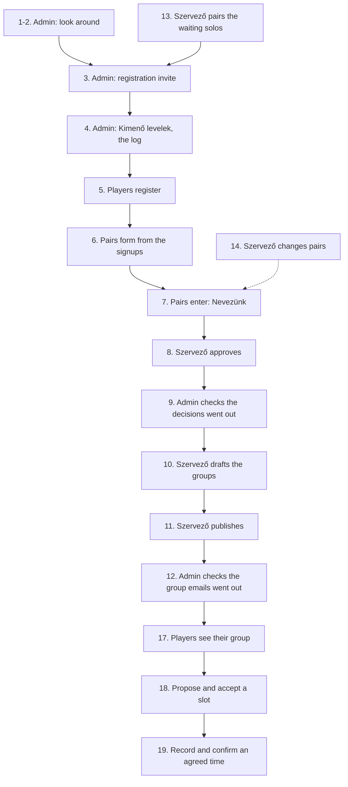

# Milestone 1 walkthrough (local)

A click-through checklist for milestone 1, "Registration opens": from the registration invite to published groups. It runs on a local database filled with fake data (#90). Nothing in it can reach production, and nothing is ever emailed: the local dev server logs every email to the console.

The page labels below are the Hungarian ones you see on screen.

`npm run e2e` runs the same steps in a browser on its own local database (#101, see the README). Which spec covers which step:

| Steps | Spec |
|---|---|
| 1-2 | [`01-admin-setup.spec.ts`](../app/e2e/01-admin-setup.spec.ts) |
| 3-4 | [`02-invite.spec.ts`](../app/e2e/02-invite.spec.ts) |
| 5-6 | [`03-register.spec.ts`](../app/e2e/03-register.spec.ts) |
| 5, partner without an email (#96) | [`04-partner-email.spec.ts`](../app/e2e/04-partner-email.spec.ts) |
| 7-9 | [`05-entries.spec.ts`](../app/e2e/05-entries.spec.ts) |
| 10-12 | [`06-groups.spec.ts`](../app/e2e/06-groups.spec.ts) |
| 11, a pair approved after publishing | [`07-late-entry.spec.ts`](../app/e2e/07-late-entry.spec.ts) |
| 13 | [`08-solos.spec.ts`](../app/e2e/08-solos.spec.ts) |
| 14 | [`09-pairs.spec.ts`](../app/e2e/09-pairs.spec.ts) |
| 15 | [`11-open-signup.spec.ts`](../app/e2e/11-open-signup.spec.ts) |

## Set up

1. Install and configure once, from the repo root:
   - `npm ci`
   - Copy `app/.dev.vars.example` to `app/.dev.vars`. Set `TURNSTILE_SITE_KEY=""` (an empty key means no bot check, so asking for a login code works locally). Leave `RESEND_API_KEY=""`, `SMTP_USER=""` and `SMTP_PASSWORD=""` empty: with a Resend key or a relay login, every email of the walkthrough would really be sent to the fake addresses. Without a relay login the daily limit is 100 (`EMAIL_DAILY_LIMIT`), about what a full run sends: set `EMAIL_DAILY_LIMIT="1000"` in `.dev.vars` so no email waits for the next day.
2. Migrate and seed the local database:
   - `npm run db:migrate:local -w app`
   - `npm run db:seed:local -w app`
3. Start the app with `npm run dev` and open <http://localhost:5173>.

The seed takes no options and refuses `--remote`, a production environment and CI. It only writes the local D1. Run it again at any time to start over: it deletes everything on `@example.test`, and the city "Mintaváros" with its league, clubs and signups (including everything a walkthrough created on top: accounts, pairs, entries, groups, emails) and writes the same starting state again. Round 1 starts on the Monday about two weeks from the day you seed.

### What the seed contains

| Thing | Value |
|---|---|
| City | Mintaváros (listed), league "Padelpárbaj Mintaváros", slug `minta` |
| Clubs | Minta Padel Aréna, Teszt Sportcentrum, Példa Padel Club |
| Season | "Teszt szezon": registration open since yesterday, closes the Sunday before round 1; round 1 starts about two weeks out |
| Admin | `admin@example.test` (Teszt Admin) |
| Szervező | `szervezo@example.test` (Teszt Szervező) of Mintaváros |
| Signups | 10 pair signups and 4 solo signups, below |
| Player accounts | none: players register in step 5 |

The Admin and the Szervező already have accounts. Everyone else has only a signup, so they register themselves.

Pair signups (both players are named, so both get the registration invite). The level is the pair's shared signup level; it prefills the first-login page.

| # | Player 1 | Player 2 | Level |
|---|---|---|---|
| 1 | Kovács Anna `kovacs.anna@example.test` | Nagy Bence `nagy.bence@example.test` | Versenyző |
| 2 | Szabó Eszter `szabo.eszter@example.test` | Tóth Gergő `toth.gergo@example.test` | Haladó |
| 3 | Horváth Zsófia `horvath.zsofia@example.test` | Molnár Dávid `molnar.david@example.test` | Haladó |
| 4 | Farkas Lilla `farkas.lilla@example.test` | Papp Ádám `papp.adam@example.test` | Középhaladó |
| 5 | Takács Nóra `takacs.nora@example.test` | Juhász Bálint `juhasz.balint@example.test` | Középhaladó |
| 6 | Mészáros Réka `meszaros.reka@example.test` | Simon Levente `simon.levente@example.test` | Középhaladó |
| 7 | Török Hanna `torok.hanna@example.test` | Fehér Márk `feher.mark@example.test` | Középhaladó |
| 8 | Balogh Petra `balogh.petra@example.test` | Rácz Zoltán `racz.zoltan@example.test` | Kezdő |
| 9 | Lakatos Vivien `lakatos.vivien@example.test` | Gulyás Tamás `gulyas.tamas@example.test` | Kezdő |
| 10 | Oláh Kinga `olah.kinga@example.test` | Fodor Péter `fodor.peter@example.test` | Kezdő |

Solo signups:

| Player | Level | State |
|---|---|---|
| Varga Dóra `varga.dora@example.test` | Középhaladó | paired with Kiss Miklós by a Szervező |
| Kiss Miklós `kiss.miklos@example.test` | Középhaladó | paired with Varga Dóra |
| Pál Boglárka `pal.boglarka@example.test` | Kezdő | waiting for a partner |
| Sándor Ákos `sandor.akos@example.test` | Haladó | waiting for a partner |

### Logging in as a seeded user

There are no passwords. On <http://localhost:5173/login>:

1. Type the address and press "Kódot kérek".
2. Read the code in the terminal where `npm run dev` runs: a line `[email] to=<address> subject=...`, with the code as `NNN NNN` in the subject and the text.
3. Type the code in "Belépőkód" and press "Belépek".

Every user needs their own session. Use one browser window per account (a private window or a separate profile), or log out first: <http://localhost:5173/logout>. The Admin's session lasts 12 hours.

### Where emails show up

Every email goes out by itself, as soon as it is made (#112). In the local dev server it is printed to the terminal as `[email] to=... subject=...` and the text, and that is how you read what a player would get. "Kimenő levelek" (`/admin/outbox`, Admin only, sidebar section Platform) is the log: per kind, how many emails wait, went out and failed, with the newest failure's reason; never an address.

The links in those emails point to `https://padelparbaj.hu/...`. Locally, open the same path on <http://localhost:5173> instead (for example `/login?email=...`).

## The flow

## Steps

Steps 1 to 12 and 17 to 19 are the main line. Steps 13 to 16 are side paths you can do any time after step 5.

### 1. Admin logs in

- Page: `/login`, then `/home` (Kezdőlap)
- Account: `admin@example.test`
- Expect:
  - You land on Kezdőlap with a "Teszt szezon" card (league Padelpárbaj Mintaváros): "Nevezés" dates, the four rounds with their deadlines, "Szezon vége:".
  - The sidebar shows "Platform" with the tag Admin, and a league section "Padelpárbaj Mintaváros" with the tag Szervező: Áttekintés, Szezonok, Párkeresők, Klubok.
  - No "Nevezünk" button: the Admin has no pair, so the card says "Nevezni párban lehet, és még nincs párod." with a link to Párom.

### 2. Admin checks the setup pages

- Account: `admin@example.test`
- Pages and expected results:
  - `/admin/cities` ("Városok"): Mintaváros is there and listed (shown on the signup form).
  - `/admin/leagues` ("Ligák"): Padelpárbaj Mintaváros with the organizer Teszt Szervező.
  - `/admin/leagues/minta/clubs` ("Klubok: Mintaváros"): the three clubs. "Inaktiválás" on one turns it off, "Aktiválás" turns it on again (deactivate instead of delete, #19). Leave all three active.
  - `/admin/leagues/minta/seasons` ("Szezonok"): the Teszt szezon with its four rounds, a link under "Nevezések" (0 jóváhagyva) and "Csoportok" under "1. kör". Try "Új szezon" with a start day that is not a Monday: it must be refused.
  - `/privacy`: opens without login; check that it describes pairs, season entries, the group emails and how long email text is kept.

### 3. Admin sends the registration invite

- Page: `/admin/signups` ("Jelentkezők")
- Account: `admin@example.test`
- Expect:
  - The header reads "14 jelentkezés · 10 pár · 4 egyéni · 24 játékos".
  - The button reads "Regisztrációs meghívó (24 cím)": both players of the 10 pair signups (20) plus all 4 solos. Pál Boglárka and Sándor Ákos still wait for a partner, so theirs says "Még keresünk neked párt, addig regisztrálj."
- Do: press the button, check the text of the dialog "Küldöd a regisztrációs meghívót?", press "Küldés".
- Expect:
  - The dialog says "Meghívók elindultak": "24 levél most megy ki, a napi limit szerint; ami ma nem fér bele, holnap." (Above 50, only the first 50 go at once and the rest hourly, within the daily limit.)
  - The button is now disabled (everyone is invited once).
  - The terminal prints 24 `[email] to=...` blocks, one per invited address, each with a link `https://padelparbaj.hu/login?email=<address>`.

### 4. Admin checks the log

- Page: `/admin/outbox` ("Kimenő levelek")
- Account: `admin@example.test`
- Expect:
  - A row "Regisztrációs meghívó" with 0 waiting, 24 sent, 0 failed, and no failure. Login codes and signup confirmations have their own rows once there are some.
  - No address anywhere on the page, and no button: nothing waits for the Admin.

### 5. Players register

- Page: `/login?email=<address>` (on localhost), then `/welcome` ("Üdv!"), then `/home`
- Accounts: the players from the tables above. Minimum: both players of 3 pair signups (6 logins, enough for one group of 3 pairs). For the full run use the 22 players who start with a partner: 11 pairs split into groups of 4, 4 and 3.
- Per player:
  1. Open the link from the terminal with the host changed to `http://localhost:5173`. The address is already filled in; press "Kódot kérek" and log in with the code from the terminal.
  2. On "Üdv!": check the line "A jelentkezésedből már megvan a neved és a szinted. Csak a telefonszámod kell, és hogy férfi vagy nő vagy.", that "Neved" already holds the name from the table and "Szinted" the signup's level (#130), leave the phone empty (or try a Hungarian number), pick "Férfi" or "Nő" (nothing is preselected, #133), tick the privacy consent and press "Kész".
- Expect:
  - Without the consent, the name or Férfi/Nő, the form shows an error and stays.
  - After "Kész" you land on Kezdőlap.
  - The first player of a pair opens "Párom" (`/pair`) and sees "A párod, <name>, még nem regisztrált." (the name, never the address).

### 6. The second partner registers, the pair forms

- Page: `/pair` ("Párom")
- Account: the second player of the pair, right after step 5 for them
- Expect:
  - After "Kész" the pair exists: Párom shows the partner's name. No invite step is needed.
  - The first partner sees the same after a reload.
  - A "Nevezés" card with the "Teszt szezon" and a "Nevezünk" button.
- Check for a pair of two solos (Varga Dóra and Kiss Miklós): the same, because the Szervező paired them before.

### 7. A pair enters the season

- Pages: `/pair` or `/home`
- Account: either player of a pair
- Do: press "Nevezünk".
- Expect:
  - "Neveztetek. A szervező döntését a Párom oldalon látjátok." and, after a reload, "Neveztetek. A szervező jóváhagyására vár."
  - The button is gone: a pair can enter a season once. The partner sees the same status.
- Repeat for every pair.

### 8. Szervező approves the entries

- Page: `/admin/leagues/minta/seasons/<id>/entries` ("Nevezések: Teszt szezon"), linked from "N függőben" on Szezonok
- Account: `szervezo@example.test` (only the Mintaváros league pages show in their sidebar)
- Expect:
  - The filter "Függőben" (default), "Jóváhagyva", "Elutasítva". Each row has the two names, their levels, the pair's average starting Elo and when they applied.
- Do: press "Jóváhagyás" on a pair, write a short message in "Üzenet (nem kötelező)", confirm. Press "Elutasítás" on another one, confirm, then change your mind with "Jóváhagyás" under "Elutasítva". Approve all the others.
- Expect:
  - The dialog says both players get an email now.
  - Approved entries show in "Jóváhagyva".
  - Back on the players' Párom: "Jóváhagyva: az 1. körtől játszotok." and "A szervező üzenete: ...".
  - The terminal prints each decision email at once, with the Szervező's message where they wrote one.

### 9. Admin checks the decisions went out

- Page: `/admin/outbox`
- Account: `admin@example.test`
- Expect: a row "Döntés a nevezésről" with two sent emails per decision (a flipped decision counts twice) and nothing waiting.

### 10. Szervező drafts the groups

- Page: `/admin/leagues/minta/seasons/<id>/groups` ("Csoportok: Teszt szezon"), the "Csoportok" link in the "1. kör" column of Szezonok
- Account: `szervezo@example.test`
- Expect before drafting: a button "Csoportok javaslata". With 0, 1, 2 or 5 approved pairs there is no draft, only a message saying why.
- Do: press "Csoportok javaslata".
- Expect:
  - Cards "1. csoport", "2. csoport", ...; the strongest pairs (by Elo) in group 1. 11 pairs make 4, 4 and 3; 10 make 4, 3 and 3. Each pair shows its Elo.
  - Move a pair with the select "N. csoportba": the target group is re-seeded. A group of 2 or 5 shows a warning badge and "Közzététel" is disabled until every group has 3 or 4 pairs.
  - "Újragenerálás" throws the moves away and drafts again.

### 11. Szervező publishes the groups

- Page: the same
- Account: `szervezo@example.test`
- Do: press "Közzététel", read "Közzéteszed a csoportokat?", confirm.
- Expect:
  - The terminal prints one email per player: the group, the opponents' names per week (or the rest week), the deadline and a link. No email address of another player is in any of them.
  - The groups are locked: no select, no "Újragenerálás". The "1. kör" link on Szezonok now reads "Közzétéve", and the season can't be edited or deleted.
  - A pair in a published group can't be dissolved or changed ("Felbontás" and "Partner cseréje" on Párok are disabled, with the reason, until the round's deadline) and its entry can't be rejected.
  - A pair approved after publishing joins round 2 (to see it, keep one pair out of steps 7 and 8 until now, then let it enter and approve it: "Jóváhagyva: a 2. körtől játszotok.").

### 12. Admin checks the group emails went out

- Page: `/admin/outbox`
- Account: `admin@example.test`
- Expect: a row "Kihirdetett csoportok" with one sent email per player and nothing waiting.

### 13. Szervező pairs the waiting solos (side path)

- Page: `/admin/leagues/minta/solos` ("Párkeresők")
- Account: `szervezo@example.test`
- Expect: "2 egyedül jelentkező keres párt, 1 párt hoztál össze": Pál Boglárka and Sándor Ákos in the table, by level. The page never shows their addresses.
- Do: tick both, press "Párba teszem (2/2)", confirm.
- Expect:
  - "0 egyedül jelentkező keres párt, 2 párt hoztál össze".
  - The terminal prints the two "Párkeresők bemutatása" emails, and "Kimenő levelek" counts them as sent.
  - They got the registration invite already (step 3). Register them as in steps 5 to 7: their pair forms like the others once both have registered. "Szétválasztom" on this page undoes a pairing.

### 14. Szervező changes pairs (side path)

Players can't invite a partner or dissolve a pair themselves: the Szervező does it.

- Page: `/admin/leagues/minta/pairs` ("Párok")
- Account: `szervezo@example.test`
- Expect: every pair of the league with both names and levels, the average starting Elo, the source ("jelentkezésből" or "kézzel"), "Aktív" or "Felbontva", and the entry status in the current season. No email address anywhere.
- Do:
  1. "Pár létrehozása": pick two registered players without a pair (for example two whose signup partner hasn't registered), press "Létrehozás". The new pair shows with "kézzel".
  2. "Partner cseréje" on a pair: pick who stays and the new partner, press "Csere". The old pair reads "Felbontva", the new one "kézzel".
  3. "Felbontás" on a pair, confirm. It reads "Felbontva"; an entry it hasn't played in reads "Visszavonva".
- Expect:
  - Nothing new in the terminal or on Kimenő levelek: no email goes out for a pair change.
  - The players see the change on Párom. From here a new pair enters the season like any other (step 7).
  - After step 11, a pair in a published group has both buttons disabled, with the reason.

### 15. A new player without a signup registers (side path)

Anyone can create an account, no invite needed (#113).

- Page: `/register` (or `/login`), then `/welcome`, `/home` and `/pair` ("Párom")
- Account: a new address that is not in the seed, for example `uj.jatekos@example.test`
- Do: ask for a login code, enter the code from the terminal, then fill in the first-login page (name, level, phone, consent) and press "Kész".
- Expect:
  - The code arrives like for anyone else; nothing about 2 November.
  - Under the code field: "Nem jött meg? Nézd meg a spam mappát is, adj meg másik címet, vagy írj nekünk: hello@padelparbaj.hu." (with "lépj be Google-lel" / "regisztrálj Google-lel" before the last part when Google login is set up). The same line for every address, also one that gets no code (#123).
  - The first-login page names no partner and prefills no level.
  - Kezdőlap and Párom: "Hívd meg a párodat" with the player's own pair link; Párom also says the organizer finds a partner for those with nobody, with the contact address `hello@padelparbaj.hu`.
  - The Szervező can now pick this player on "Párok" (step 14).

### 16. The new player invites a partner with the pair link (side path)

A player without a pair sends their own link; the partner registers and accepts (README decision log, 2026-10-31).

- Page: `/home` as the player of step 15, then the link in a private window, `/register`, `/welcome`, the link again, `/pair`
- Account: another new address, for example `link.partner@example.test`
- Do: copy the link from "Hívd meg a párodat", open it in a private window, press "Regisztrálok", ask for a code, enter it, fill in the first-login page, then press "Elfogadom".
- Expect:
  - Logged out, the link shows "Új Játékos meghívott, hogy legyél a párja." and the league, never an email.
  - `/register` says "Regisztráció" and "Regisztráció Google-lel", the code step "Tovább"; it is the login flow.
  - After "Kész" the partner is back on the link; "Elfogadom" opens Párom with "Mostantól párban vagytok." and the partner's name.
  - Both players' link boxes are gone; on "Párok" the pair's source is "linkkel". No email was queued.
  - The player's own link, opened by themselves, says "Ez a saját linked."

### 17. Players see their group (after step 11)

- Page: `/home` ("Kezdőlap")
- Account: any player in a published group, for example the first pair's first player
- Expect:
  - "Teendők" at the top: "Ajánlj időpontot (<names> ellen)" for each match, each a link to the match.
  - A card "Bronz divízió, 1. csoport" (or "Réz divízió, 2. csoport"): the season, the round and the deadline, the group's pairs with "(ti)" on yours, then weeks 1 to 3. With 6 pairs the groups have 3 pairs: 2 matches and one "Pihenőhét".
  - Each match: the opponents, "Egyeztetésre vár", their two phone numbers (tap to call) and "Egyeztetés és részletek". No email address anywhere.
  - "Hamarosan itt lesz a csoportod" is gone.

### 18. A pair proposes slots, the other accepts one

- Page: `/matches/<id>` (from "Egyeztetés és részletek"), then the same as an opponent
- Accounts: the player of step 17, then one of the opponents
- Do: fill two times on the same day and press "Elküldöm az időpontokat"; then three times on two days, at least 48 hours ahead, and send again.
- Expect:
  - The page shows "Hogyan egyeztessetek?" with the 3-sentence guide.
  - The first try is refused: "Legalább 3 különböző időpontot ajánlj." and "Az időpontok legalább 2 különböző napra essenek." (a time before 7:00 or after 22:00, or under 48 hours ahead, gets its own message under its row).
  - The second goes through: "Elküldtük az időpontokat a másik párnak.", the status "Ajánlottatok időpontokat, a másik pár válaszára vár". The terminal prints "Időpontokat ajánlottak a meccsetekre" to both opponents, with the link.
  - As the opponent: Kezdőlap's Teendők has "Válaszolj az időpont-ajánlatra"; on the match, pick a time and press "Elfogadom": "Lefixáltátok a meccset.", "Lefixálva: <time>". "Napló" lists both steps with who and when. No email for the acceptance (it is a daily-digest item, #31); both pairs see it in "Értesítések".
  - Instead of accepting, the opponent can send their own times ("Új időpontok ajánlása"): it replaces the first proposal.

### 19. A pair records an agreed time, the other confirms

- Page: the player's other match, then the same as an opponent
- Do: under "Már megbeszéltétek?" fill tomorrow 23:00 and press "Rögzítem az időpontot"; as an opponent, press "Megerősítem" (or "Nem így beszéltük").
- Expect:
  - Any future time before the deadline is fine, late evening too. "Rögzítettük. A másik pár megerősíti."; the terminal prints "Erősítsd meg a meccs időpontját" to both opponents.
  - Confirmed: "Lefixálva: <time>" for both pairs. Declined: back to "Egyeztetésre vár", and the recording pair gets an in-app notification.
  - Any other player opening `/matches/<id>` gets "Ez az oldal nem létezik."

### 20. A pair records the result, the other confirms

- Page: the match of step 18 (`/matches/<id>`), then the same as an opponent
- Accounts: the player of step 17, then one of the opponents
- Do: under "Eredmény rögzítése" fill 4:3 and 4:1 ("Ti" first) and press "Rögzítem az eredményt"; then 4:1, 2:4 and the super tie-break 10:8, and send again. As the opponent, press "Megerősítem".
- Expect:
  - The first try is refused: "1. szett: 4:3 nem lehet. Lehet 4:0, 4:1, 4:2, 5:3 vagy (tie-break után) 5:4."
  - The second goes through: "Rögzítettük. A másik pár megerősíti.", the status "Rögzítettétek: 4:1, 2:4, szuper tie-break 10:8, a másik pár megerősítésére vár", with the time it is accepted by itself (48 hours later). Scheduling is gone from the page. The terminal prints "Erősítsd meg a meccs eredményét" to both opponents, with the score from their side (1:4, 4:2, 8:10) and the link.
  - Until the other pair answers, the recording pair can correct it ("Elírtátok? Javítsd ki"); the 48 hours restart.
  - As the opponent: Kezdőlap's Teendők has "Erősítsd meg az eredményt"; on the match, "Megerősítem": "Megerősítetted, az eredmény végleges.", "Lejátszva: 1:4, 4:2, szuper tie-break 8:10 (kikaptatok)". "Napló" lists both steps. No email for the confirmation (a daily-digest item, #31); all four players see it in "Értesítések".
  - Instead of confirming, "Nem így volt?" takes the opponent's own score (and an optional note): "Jeleztük a szervezőnek, ő dönt.", the status "Vitatott eredmény, a szervező dönt", and the match doesn't count until the organizer decides (step 21).
  - A result nobody answers is accepted by the hourly cron 48 hours after it was recorded; locally the cron doesn't run.

## Start over

Run `npm run db:seed:local -w app` again. It resets the fake rows, including every account, session, pair, entry, group, match and email of the walkthrough, and refreshes the season dates. Rows that are not on `@example.test` and not in the city "Mintaváros" are left alone.

## What is not covered

- Google login (needs real credentials), web push and the Turnstile widget.
- Production behavior: real delivery through the Google SMTP relay or Resend, the daily limit in a live account, DNS and the deploy. Email is checked here only up to the terminal output.
- Milestone 2 and later: venue and cancelling (#27), standings, reminders.
- The 48-hour auto-accept of a result (#28): the hourly cron doesn't run in local dev; the unit tests cover it.
